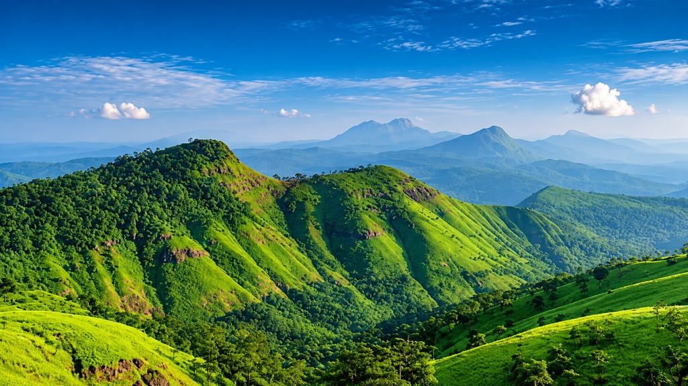
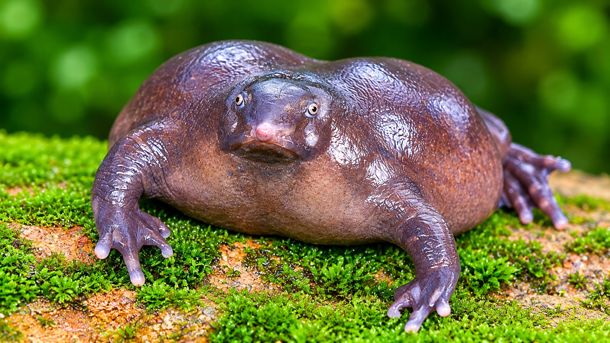
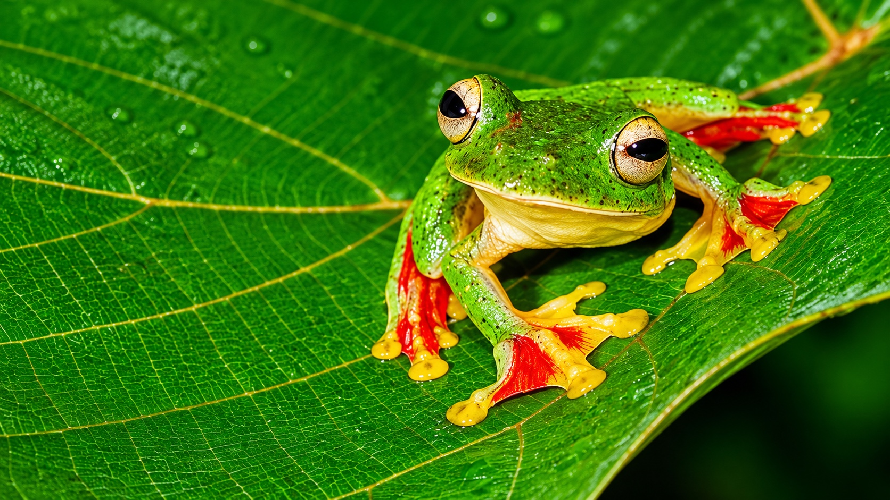
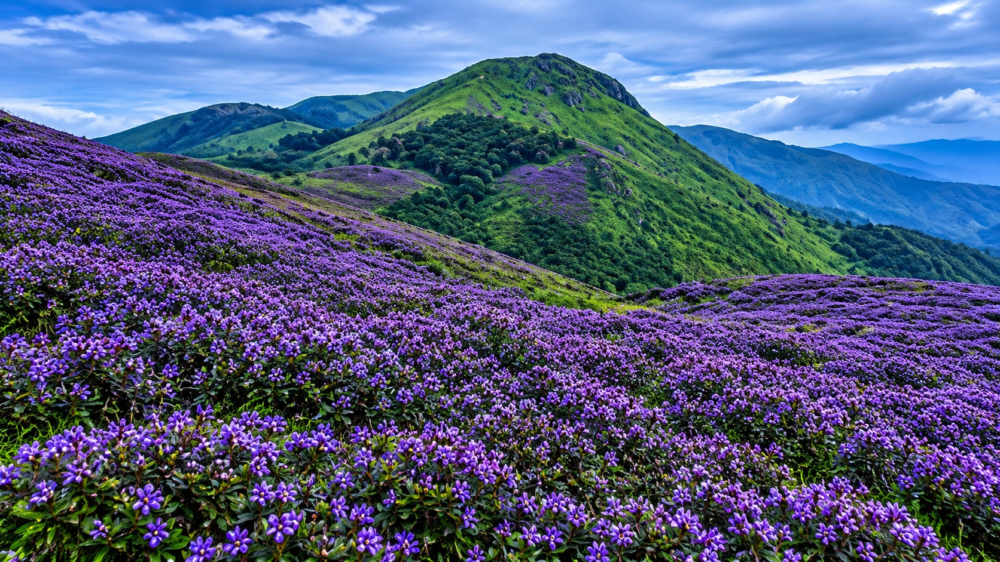

# 🌱 Green Tomorrow — Sustaining the Western Ghats

> **An immersive, open-source biodiversity documentary & ecological stewardship web platform.**  
> Built for **TERRACODE 2026** — Online Website Competition by **FOSS Club**, Department of Computer Science & Engineering, MEA Engineering College.  
> **Theme:** *Green Tomorrow – Building a Sustainable Future*  
> **License:** Open Source (MIT)

---

## 🔗 Project Links & Team Information

- **Live URL:** [https://terracode-sooty.vercel.app/](https://terracode-sooty.vercel.app/) <!-- [Insert your custom production link here] -->
- **GitHub Repository:** [https://github.com/thisiskishanr-cloud/terracode](https://github.com/thisiskishanr-cloud/terracode)

### Team Members
- **Team Lead / Developer:** *[Your Name Here]* (`your.email@example.com`)
- **Designer / Research:** *[Team Member Name]* (`member.email@example.com`)
- **Institution:** MEA Engineering College, Perinthalmanna, Kerala

---

## 🌍 The Sustainability Problem & "Green Tomorrow" Alignment

The **Western Ghats**, older than the Himalayas, is recognized by UNESCO and the International Union for Conservation of Nature (IUCN) as one of the world's eight "hottest hotspots" of biological diversity. Traversing Kerala's eastern spine, these mist-shrouded forested ridges capture the Arabian Sea monsoon, giving birth to **44 perennial rivers** that sustain over 40 million people and countless endemic wildlife species.

Today, this delicate planetary cradle faces mounting ecological pressures:
1. **Severe Habitat Fragmentation:** Linear road cuts and development sever ancient elephant migration corridors and arboreal highways.
2. **Loss of Keystone Flora & Fauna:** Threats to endemic seed dispersers (such as the Malabar Grey Hornbill and Malabar Giant Squirrel) collapse the natural forest regeneration cycle.
3. **Subterranean Hydrological Degradation:** Siltation and monoculture encroachments compromise natural water-sponge basins, threatening living fossils like the Purple Frog (*Nasikabatrachus sahyadrensis*).

### How Green Tomorrow Solves This
Instead of generic climate despair or static text, **Green Tomorrow** translates complex ecological data into an **interactive, scroll-based sensory narrative**:
- **Educates & Demystifies:** Introduces citizens and researchers to Western Ghats species found nowhere else on planet Earth.
- **Empirical Watershed Tracking:** Features an interactive stream chemistry laboratory station for regional watersheds.
- **Ecological Energy Alternatives:** Explores decentralized, fish-safe, low-impact clean energy solutions (agrivoltaics, bio-grids, tidal rotors) that power forest-fringe communities without damming pristine rivers.
- **Grassroots Empowerment:** Showcases regional citizen science initiatives across Kerala to inspire community rewilding and field reporting.

---

## 📸 Screenshots & Visual Walkthrough

*(Place your website screenshots in `assets/screenshots/` and update paths below)*

| 3D Living Botanical Specimen (Hero) | Endemic Species Accordion Gallery (Chapter 02) |
| :---: | :---: |
|  |  |

| Spatial Habitat Cartography (Chapter 03) | Decentralized Clean Energy 3D Stage (Chapter 06) |
| :---: | :---: |
|  |  |

---

## ✨ Features & Interactive Architecture

The platform is structured into a continuous, cinematic 7-chapter storytelling experience:

1. **Interactive 3D Shola Specimen (Hero Viewport)**
   - High-fidelity Three.js 3D rainforest tree specimen with real-time shadow projection, orbital damping, and camera perspective controls (*Canopy Top*, *Bark Detail*, *Reset Center*).
   - Dynamic foliage overlay where leaves and branches drape organically across the headline typography.

2. **Chapter 01: The Beginning — An Ancient Sanctuary of Life**
   - High-definition photographic hero introducing the geographic expanse, evolutionary age, and monsoon capture mechanics of the Western Ghats.

3. **Chapter 02: Endemic Species Guide & Living Fossil Spotlight**
   - **Interactive Accordion Gallery:** Hardware-accelerated 3D perspective gallery featuring 6 real endemic species with hover expansion, grayscale-to-color transition, and parallax image drift.
   - **Verified Fauna & Flora Categorization:** 5 animal species (*Malabar Giant Squirrel*, *Malabar Grey Hornbill*, *Purple Frog*, *Nilgiri Langur*, *Malabar Gliding Frog*) and 1 plant species (*Neelakurinji*).
   - **Interactive Scientific Dossier Modal:** Clicking any card opens an in-depth scientific popup with biological classifications, habitat requirements, ecological roles, and verified authorities.
   - **Living Fossil Feature Card:** Dedicated editorial spotlight on *Nasikabatrachus sahyadrensis* (Purple Frog), detailing its subterranean ecology.

4. **Chapter 03: Spatial Cartography — Protected Sanctuaries & Corridors**
   - Interactive Leaflet.js GIS map centered on the Kozhikode and Western Ghats bio-reserves.
   - Custom SVG botanical markers, dynamic location telemetry, and interactive fly-to coordinates for Kadalundi Estuary, Sarovaram Wetland, Kakkayam Reserve, and Janakikkadu Forest.

5. **Chapter 04: The Warning — Ecological Pressures & Habitat Fragmentation**
   - Interactive spotlight cards detailing linear infrastructure dissection, Shola monoculture encroachment, and invasive species pressures.

6. **Chapter 05: Watershed Health Station & Biometric Monitoring**
   - Real-time empirical stream chemistry selector comparing Kadalundi Estuary, Chaliyar River, Kallai Estuary, and Kakkayam Headwaters across 6 critical parameters: pH level, Dissolved Oxygen (DO), Turbidity, Water Temperature, Electrical Conductivity, and Nitrates.
   - Clear benchmarking against Kerala State Pollution Control Board environmental baselines.

7. **Chapter 06: Conservation in Action & Ecological Clean Energy**
   - Four actionable community stewardship pathways: *Observe*, *Measure*, *Protect*, and *Restore*.
   - **Decentralized Clean Energy Experience:** Kinetic orbital wheel showcasing 8 low-impact renewable energy technologies designed to protect river basins, paired with an interactive 3D offshore wind turbine on a floating bio-island.
   - **Green Citizen Wall:** Grassroots community showcase celebrating conservation contributions from students, researchers, and indigenous stewards across Kerala.

8. **Minimal Modern Botanical Footer**
   - Clean, zero-emoji, high-contrast dark botanical footer (`#061811`) with internal navigation, conservation links, verified data source citations, and precise GPS coordinates (`11.2588° N, 75.7804° E • Kozhikode & Western Ghats, Kerala`).

---

## 🛠 Technology Stack & FOSS Library Credits

In strict alignment with the **FOSS Club** philosophy, the project is constructed entirely from open-source web standards without proprietary frameworks, commercial SaaS dependencies, or hidden paywalls:

- **Core Frontend:** Plain Semantic **HTML5**, **Modern CSS3** (CSS Grid, Flexbox, CSS Variables, `clamp()`, backdrop filters), and native **ES6 JavaScript Modules**.
- **Zero Build Tools Required:** Runs natively in any modern browser without requiring `npm install`, Node.js runtimes, Vite, or Webpack.
- **3D Graphics Engine:** [Three.js](https://threejs.org/) (r164) — MIT License. Powering the photorealistic PBR rendering, glTF binary decompression, and orbital camera controls.
- **Geospatial Mapping:** [Leaflet.js](https://leafletjs.com/) (v1.9.4) with [OpenStreetMap](https://www.openstreetmap.org/copyright) tiles — BSD-2-Clause License & ODbL.
- **Kinetic Animations:** [GSAP (GreenSock)](https://gsap.com/) — Standard License for web animation and fluid layout transitions.
- **Typography:** Open-source Google Fonts:
  - *Space Grotesk* (OFL License by Florian Karsten)
  - *Playfair Display* (OFL License by Claus Eggers Sørensen)
  - *Inter* (OFL License by Rasmus Andersson)

---

## 📚 Verified Scientific Data Sources

In adherence to Hard Rule 2 (*No false or made-up facts*), every metric, scientific name, and benchmark is cited from verified public authorities:

1. **[IUCN Red List of Threatened Species](https://www.iucnredlist.org/)**: Conservation status assessments for *Ratufa indica* (Least Concern), *Ocyceros griseus* (Vulnerable), *Nasikabatrachus sahyadrensis* (Endangered), *Semnopithecus johnii* (Vulnerable), and *Rhacophorus malabaricus* (Least Concern).
2. **[Kerala State Pollution Control Board (KSPCB)](https://keralapcb.nic.in/)**: Environmental river water quality monitoring guidelines and baseline biochemical indicators for Kerala river basins.
3. **[Botanical Survey of India (BSI)](https://bsi.gov.in/)**: Western Ghats plant endemism records, Shola flora catalogs, and *Strobilanthes kunthiana* flowering cycle documentation.
4. **[Zoological Survey of India (ZSI)](https://zsi.gov.in/)**: Amphibian and mammalian inventories of the Western Ghats biodiversity hotspot.
5. **[IPBES Global Assessment Report on Biodiversity](https://ipbes.net/global-assessment)**: Global ecological tipping points, habitat connectivity research, and ecosystem service valuation models.
6. **[UNESCO World Heritage Centre](https://whc.unesco.org/en/list/1342/)**: Serial site inscription data for the 39 protected natural reserves forming the Western Ghats World Heritage cluster.

---

## 🚀 Setup & Run Instructions

The repository is built as a zero-dependency static site. You can run it instantly with any local web server:

### Option 1: Python (Built into macOS, Linux, and Windows)
```bash
# 1. Clone the repository
git clone https://github.com/thisiskishanr-cloud/terracode.git

# 2. Enter the project directory
cd terracode

# 3. Start a local server
python3 -m http.server 8080
```
Open **[http://localhost:8080](http://localhost:8080)** in your web browser.

### Option 2: Node.js / npx
```bash
npx serve .
```

### Option 3: VS Code Live Server
Right-click `index.html` inside VS Code and choose **"Open with Live Server"**.

### Deploying to Vercel / GitHub Pages
- **Vercel:** Connect the GitHub repository directly to Vercel; zero build commands or output directories are needed (`vercel.json` is already configured).
- **GitHub Pages:** Go to **Settings > Pages > Branch: main / root** and click Save.

---

## 🤖 Note on AI Assistance

In full transparency as permitted by the competition guidelines:
- **AI Tools Used:** Google Antigravity / Gemini was utilized as a development, coding, and code-refactoring assistant during project creation.
- **Human Oversight:** All architectural design decisions, environmental themes, regional Kerala context selection, species mapping, factual verification against official Indian portals (BSI, ZSI, KSPCB), and final creative alignments were directed by the human author.

---

## 📁 Repository Directory Structure

```
terracode/
├── index.html                       # Primary single-page application entry point
├── README.md                        # Project documentation, data sources, and competition brief
├── LICENSE                          # MIT Open Source License
├── vercel.json                      # Vercel static routing & cache headers
├── .gitignore                       # Standard OS and editor exclusions
├── assets/
│   ├── images/
│   │   ├── western-ghats.jpg        # High-resolution Western Ghats landscape
│   │   └── species/                 # Endemic flora & fauna photographic assets
│   │       ├── malabar-giant-squirrel.jpg
│   │       ├── malabar-gliding-frog.jpg
│   │       ├── malabar-grey-hornbill.jpg
│   │       ├── neelakurinji.jpg
│   │       ├── nilgiri-langur.jpg
│   │       └── purple-frog.jpg
│   ├── models/
│   │   ├── tree.glb                 # 3D Shola forest specimen (Three.js)
│   │   └── wind-turbine.glb         # 3D offshore wind turbine specimen
│   └── textures/
│       └── earth-texture.jpg        # Spherical planetary Earth texture
├── css/
│   ├── accordion-gallery.css        # Interactive species expanding accordion styling
│   ├── orbital-image-wheel.css      # Decentralized clean energy orbital wheel styling
│   └── spotlight-card.css           # Mouse-tracking spotlight card shader styling
└── js/
    ├── accordion-gallery.js         # GSAP accordion logic, tilt, and parallax drift
    ├── orbital-image-wheel.js       # Discrete wheel scroll & 3D tangent transformation
    └── spotlight-card.js            # Kinetic spotlight glow & grain shader module
```

---

*Submitted for **TERRACODE 2026** — Organized by FOSS Club, MEA Engineering College.*
